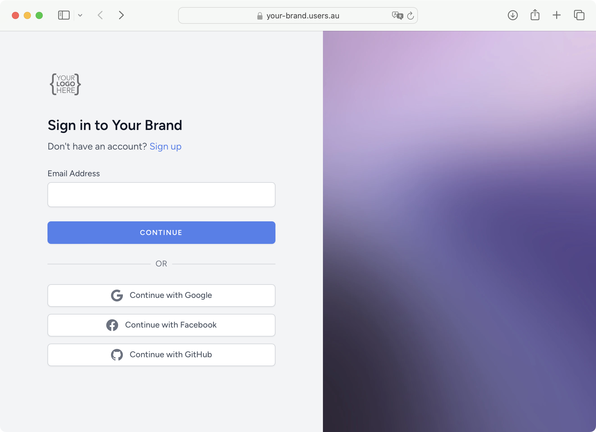

<div align="center">

# Users.au Laravel Client

**Bring hosted identity into your Laravel application.**

[Quick start](#installation) · [Configuration](#configuration) · [Screenshots](#usersau-in-action) · [Users.au](https://www.users.au)

[](https://packagist.org/packages/users-au/laravel-client) [](https://packagist.org/packages/users-au/laravel-client) [](https://github.com/Users-au/laravel-client/actions/workflows/tests.yml) [](https://opensource.org/licenses/MIT) [](https://github.com/Users-au/laravel-client/issues) [](https://github.com/Users-au/laravel-client/pulls)

</div>

Add Users.au OAuth routes, synchronize users into your application's model,
and connect account management and coordinated sign-out.

```bash
composer require users-au/laravel-client
```

| 🔐 OAuth routes | 👤 Local users | 🎨 Your application |
| --- | --- | --- |
| Login, registration, callback, account and logout routes. | Configurable user model and optional profile-photo column. | Keep your Laravel UI, database and application permissions. |

> [!TIP]
> Starting a new application? Try the [Laravel starter kit](https://github.com/Users-au/laravel-starter-kit).
> Need to own the Socialite flow yourself? Use the [Socialite provider](https://github.com/Users-au/socialite-provider).

## Users.au in action

Users.au hosts the authentication experience on your identity domain. Enable the
sign-in methods available to your project and connect them to your application
through OAuth. These official product screenshots show the hosted experience.

<table>
  <tr><th>🔑 Branded sign-in & social providers</th><th>🛡️ Multi-factor authentication</th></tr>
  <tr>
    <td width="50%"><a href="docs/images/usersau-social.png"></a></td>
    <td width="50%"><a href="docs/images/usersau-mfa.png"></a></td>
  </tr>
</table>

<details>
<summary><strong>👆 Preview the passkey experience</strong></summary>


</details>

[Explore Users.au](https://www.users.au) · [Create a project](https://my.users.au) · [Image sources](docs/images/README.md)

## Documentation

[Requirements](#requirements) · [Install](#installation) · [Configuration](#configuration) · [Usage](#usage) · [API](#api-reference) · [Troubleshooting](#troubleshooting)

## Requirements

- [PHP](https://php.net) >= 8.0
- [Composer](https://getcomposer.org) >= 2.0
- Illuminate/Laravel component constraints: 5.x–12.x in `composer.json`; choose a compatible PHP/framework combination. The current CI matrix exercises Laravel 8–10.
- Users.au OAuth application credentials

## Installation

Install the package via Composer:

```bash
composer require users-au/laravel-client
```

Publish the package assets:

```bash
php artisan vendor:publish --provider="Usersau\UsersauLaravelClient\UsersauLaravelClientServiceProvider"
```

Run the migrations to add required columns to your users table:

```bash
php artisan migrate
```

## Configuration

### 1. Update Your User Model

Add the following fields to your User model's `fillable` and `hidden` arrays:

```php
// app/Models/User.php

protected $fillable = [
    // ... existing fields
    'usersau_id',
    'usersau_access_token',
    'usersau_refresh_token',
];

protected $hidden = [
    // ... existing fields
    'usersau_id',
    'usersau_access_token',
    'usersau_refresh_token',
];
```

### 2. Service Configuration

Add Users.au configuration to your `config/services.php`:

```php
'usersau' => [    
    'client_id' => env('USERSAU_CLIENT_ID'),  
    'client_secret' => env('USERSAU_CLIENT_SECRET'),  
    'redirect' => env('USERSAU_REDIRECT_URI'),
    'host' => env('USERSAU_HOST'),
],
```

### 3. Environment Variables

Set the following environment variables in your `.env` file:

```env
USERSAU_CLIENT_ID="your_client_id"
USERSAU_CLIENT_SECRET="your_client_secret"
USERSAU_REDIRECT_URI="https://yourdomain.com/auth/usersau/callback"
USERSAU_HOST="https://auth.yourdomain.com"
```

The current login controller requests `openid`, `profile` and `email` scopes.
Confirm those names are supported by your OAuth registration. Scope requirements
can differ between registrations; inspect the generated authorization request
when diagnosing `invalid_scope`.

### 4. Package Configuration

The package publishes a configuration file at `config/usersau.php`. You can customize:

```php
return [
    'after_login_url' => '/',              // Redirect after successful login
    'after_logout_url' => '/',             // Redirect after logout
    'after_register_url' => '/',           // Redirect after registration
    'user_model' => App\Models\User::class, // Your user model
    'middleware' => ['web'],               // Middleware for auth routes
    'profile_photo_column' => null,        // Column name for profile photos (optional)
];
```

### 5. Manual Service Provider Registration (Optional)

If auto-discovery is disabled, manually register the service provider in `config/app.php`:

```php
'providers' => [
    // ... other providers
    Usersau\UsersauLaravelClient\UsersauLaravelClientServiceProvider::class,
],
```

## Usage

### Authentication Routes

The package automatically registers the following routes:

| Route | Name | Description |
|-------|------|-------------|
| `GET /auth/usersau/redirect` | `usersau.login` | Initiates OAuth flow |
| `GET /auth/usersau/callback` | - | OAuth callback handler |
| `GET /auth/usersau/logout` | `usersau.logout` | Logout and redirect to Users.au |
| `GET /auth/usersau/register` | `usersau.register` | Redirect to Users.au registration |
| `GET /auth/usersau/account` | `usersau.account` | Redirect to Users.au account page |

### Basic Usage Examples

#### Login Link

```php
// In your Blade template
<a href="{{ route('usersau.login') }}" class="btn btn-primary">
    Login with Users.au
</a>
```

#### Logout Link

```php
<a href="{{ route('usersau.logout') }}" class="btn btn-secondary">
    Logout
</a>
```

#### Registration Link

```php
<a href="{{ route('usersau.register') }}" class="btn btn-success">
    Register with Users.au
</a>
```

#### Account Management Link

```php
@auth
<a href="{{ route('usersau.account') }}" class="btn btn-info">
    Manage Account
</a>
@endauth
```

### Middleware Protection

Protect your routes using Laravel's built-in auth middleware:

```php
// In your routes/web.php
Route::middleware('auth')->group(function () {
    Route::get('/dashboard', [DashboardController::class, 'index']);
    Route::get('/profile', [ProfileController::class, 'show']);
});
```

### Custom User Handling

You can listen for authentication events to perform custom actions:

```php
// In a service provider
Event::listen(\Illuminate\Auth\Events\Login::class, function ($event) {
    // Custom logic after user login
    $user = $event->user;
    
    // Log login activity
    activity()
        ->performedOn($user)
        ->log('User logged in via Users.au');
});
```

## API Reference

### AuthController Methods

The `AuthController` provides the following public methods:

#### `redirect()`
Initiates the OAuth flow by redirecting to Users.au.

#### `callback()`
Handles the OAuth callback, creates/updates user records, and logs in the user.

**Process:**
1. Retrieves user data from Users.au
2. Creates or updates local user record
3. Syncs profile photo (if configured)
4. Logs in the user
5. Redirects to configured URL

#### `logout()`
Logs out the user locally and redirects to Users.au logout.

#### `account()`
Redirects authenticated users to their Users.au account page.

#### `register()`
Redirects to Users.au registration page.

### Configuration Options

| Option | Type | Default | Description |
|--------|------|---------|-------------|
| `after_login_url` | string | `'/'` | URL to redirect after login |
| `after_logout_url` | string | `'/'` | URL to redirect after logout |
| `after_register_url` | string | `'/'` | URL to redirect after registration |
| `user_model` | string | `App\Models\User::class` | User model class |
| `middleware` | array | `['web']` | Middleware for auth routes |
| `profile_photo_column` | string|null | `null` | Database column for profile photos |

## Migration Guide

Review the target release and back up your application's published configuration
before updating:

```bash
composer update users-au/laravel-client --with-dependencies
```

Compare changed package configuration and migration files with your application's
copies before publishing or running them. Preserve existing secrets, local
configuration and user data, then verify login, callback, user mapping and logout
in your target environment.

## Troubleshooting

### Common Issues

#### "Invalid State Exception"
This usually occurs when the OAuth state parameter doesn't match. Common causes:
- Session configuration issues
- Multiple redirect attempts
- Browser security settings

**Solution:** Ensure your session driver is properly configured and cookies are enabled.

#### "Client Exception during OAuth"
This indicates communication issues with Users.au servers.

**Solutions:**
- Verify your `USERSAU_CLIENT_ID` and `USERSAU_CLIENT_SECRET`
- Check your `USERSAU_REDIRECT_URI` matches exactly what's configured in Users.au
- Ensure `USERSAU_HOST` is correct

#### "User Model Not Found"
The configured user model doesn't exist.

**Solution:** Verify the `user_model` in `config/usersau.php` points to your correct User model.

#### Migration Errors
Issues running the package migrations.

**Solutions:**
- Ensure your users table exists before running migrations
- Check for conflicting column names
- Verify database connection

### Debug Mode

Enable debug mode in your `.env` for detailed error messages:

```env
APP_DEBUG=true
LOG_LEVEL=debug
```

### Support

For additional support:
- Check the [GitHub Issues](https://github.com/users-au/laravel-client/issues)
- Review the [Users.au Documentation](https://www.users.au/docs)
- Contact support at [support@users.au](mailto:support@users.au)

## Choose your integration

| Project | Use it when you want to… |
| --- | --- |
| [Next.js starter](https://github.com/Users-au/nextjs-starter-kit) | Start a Next.js app with server-managed OAuth sessions and a protected dashboard. |
| [Laravel starter](https://github.com/Users-au/laravel-starter-kit) | Start a Laravel app with Blade templates and Users.au integration. |
| [**Laravel client — this repo**](https://github.com/Users-au/laravel-client) | Add local user synchronization and authentication routes to a Laravel app. |
| [Socialite provider](https://github.com/Users-au/socialite-provider) | Connect an existing Laravel Socialite authentication flow to Users.au. |
| [Frontend client](https://github.com/Users-au/frontend-client) | Use public-client OAuth with PKCE in JavaScript, Vue or React. |

## Contributing

We welcome contributions! Please see [CONTRIBUTING.md](CONTRIBUTING.md) for details.

### Development Setup

1. Clone the repository
2. Install dependencies: `composer install`
3. Run tests: `composer test`
4. Follow PSR-12 coding standards

### Testing

Run the test suite:

```bash
composer test
```

For coverage reports:

```bash
vendor/bin/phpunit --coverage-html coverage
```

## Changelog

Please see [CHANGELOG.md](CHANGELOG.md) for more information on what has changed recently.

## License

The MIT License (MIT). Please see [LICENSE.md](LICENSE.md) for more information.

### Platform authentication with per-request site context

A platform can use one confidential client and one Users.au tenant for all of its sites. The identity provider must implement `/oauth/par` and explicitly opt this client into dynamic contexts. No per-site OAuth keys or persistent branding synchronization are required.

Implement `Usersau\UsersauLaravelClient\Contracts\AuthContextProvider::context()` in the consuming app. Return `store_id`, `branding` (`name`, optional HTTPS `logo_url`, `logo_dark_url`, `favicon_url`, six-digit `theme_color`), and `links` (`home_url`, optional HTTPS `support_url`). Resolve all values from your server-side tenant registry; never copy callback URLs or branding directly from browser input.

```php
$url = (new \Usersau\UsersauLaravelClient\OAuth\PushedAuthorizationClient([
    'host' => config('services.usersau.host'),
    'client_id' => config('services.usersau.client_id'),
    'client_secret' => config('services.usersau.client_secret'),
]))->authorizationUrl([
    'redirect_uri' => $trustedStoreCallback,
    'state' => $sessionBoundRandomState,
    'code_challenge' => $s256Challenge,
], app(\Usersau\UsersauLaravelClient\Contracts\AuthContextProvider::class));
```

The SDK submits credentials via HTTP Basic over HTTPS and context as JSON inside the form body. The browser receives only `client_id` and a short-lived `request_uri`. Continue using authorization-code exchange, S256 PKCE, one-time state and the exact callback from the initiating session. Provider errors expose no response bodies. This is an opt-in service; legacy SDK routes and login behavior remain unchanged. Set `usersau.routes_enabled=false` when an app owns its authentication controllers and uses only this service.

Identity remains shared in the Users.au tenant; the consuming app owns store-local user records and their links to the provider subject. The server contract and lifecycle are documented by the auth-tenant implementation; PAR follows RFC 9126, with the `context` extension defined here. Future context fields require an explicit contract update.
